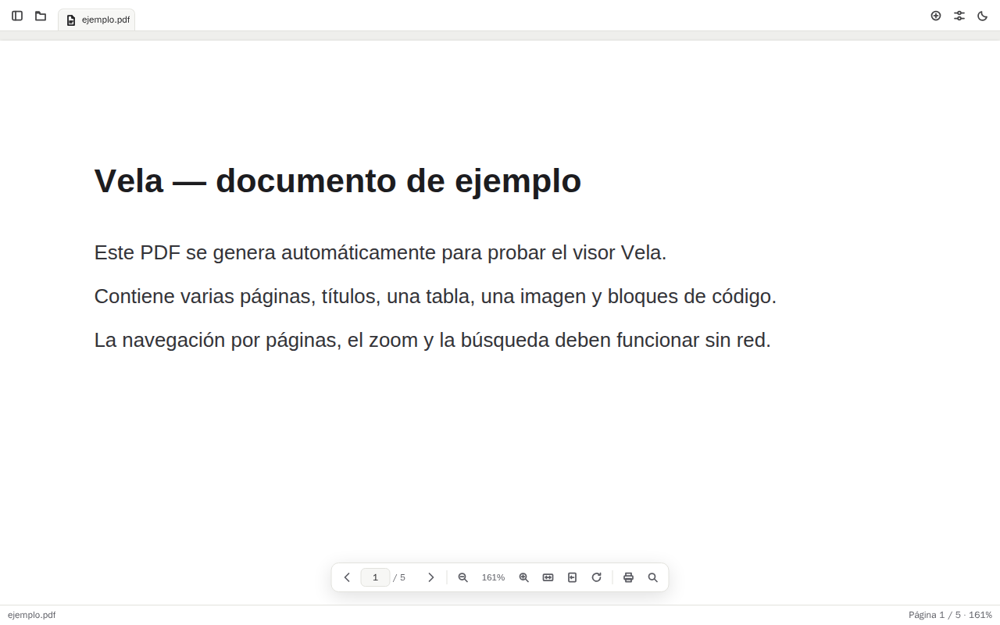

# Vela

**Visor local de PDF y Markdown.** Rápido, sobrio y completamente offline: sin cuentas,
sin nube, sin analítica. Pensado para leer, consultar y organizar documentos con la
misma ligereza que un visor clásico, pero con una interfaz moderna y cuidada.



## Qué incluye

**PDF** — pdf.js como motor de render:
navegación por páginas, zoom (acercar/alejar/100 %), ajuste a página y a ancho, rotación,
búsqueda de texto con resaltado, selección y copia de texto, impresión, apertura por
arrastrar y soltar, historial de recientes, marcadores de páginas y panel lateral
plegable con miniaturas, índice del documento y marcadores. Al reabrir un PDF se
restaura la última página, el zoom y el modo de ajuste (página/ancho).

**Markdown** — CodeMirror 6 + markdown-it:
render limpio (títulos, listas, tablas, enlaces, imágenes, código con resaltado y
citas), vista dividida entre edición y previsualización con actualización en vivo,
modo solo lectura, esquema del documento y explorador de carpeta para trabajar con
varios archivos relacionados. Exportación a HTML y a PDF (mediante impresión local).
Autoguardado de borradores de recuperación sin tocar el archivo original (con
«Restaurar borrador / Descartar» al reabrir) y autoguardado en el archivo opcional,
desactivado por defecto.

**Interfaz** — pestañas compactas (abrir, cerrar, reordenar, indicador de cambios sin
guardar, restauración de sesión, menú contextual), tema claro/oscuro/sistema con
color de acento, paleta de comandos (Ctrl+K), atajos de teclado configurables,
estados vacíos/error/documento protegido explicados, y arrastrar y soltar archivos.
Panel de Ajustes (Ctrl+,): tipografía del editor y la previsualización, tema, acento
y gestión de atajos (reasignar, detectar conflictos, restablecer).

## Requisitos

- Node.js ≥ 20 (recomendado 22)
- Para la app de escritorio: [Rust](https://rustup.rs) + dependencias de Tauri 2
  (ver [docs/BUILD.md](docs/BUILD.md))

## Puesta en marcha

```bash
npm install

# Desarrollo (interfaz en el navegador, sin Tauri)
npm run dev            # http://localhost:5199

# Pruebas
npm run typecheck      # tipos
npm test               # unitarias (lógica, Markdown, atajos)
npm run fixtures       # genera fixtures/ (PDF y Markdown de prueba)
npm run test:e2e       # funcionales + capturas de pantalla

# App de escritorio
npm run tauri:dev      # desarrollo con ventana nativa
npm run tauri:build    # empaqueta .deb/.AppImage/.msi/.nsis/.dmg
```

La aplicación funciona en dos modos con el mismo código:

- **Escritorio (Tauri):** diálogos nativos, rutas reales, sesión restaurable,
  asociación de extensiones `.pdf`, `.md`, `.markdown`, `.mdown`.
- **Navegador (desarrollo/pruebas):** usa File System Access API cuando existe y
  `<input type=file>` como respaldo. Útil para probar sin compilar Rust.

## Documentación

| Documento | Contenido |
| --- | --- |
| [docs/BUILD.md](docs/BUILD.md) | Compilar, empaquetar, iconos, asociaciones |
| [docs/ARCHITECTURE.md](docs/ARCHITECTURE.md) | Arquitectura y decisiones técnicas |
| [docs/SHORTCUTS.md](docs/SHORTCUTS.md) | Atajos: registro, reasignación y conflictos |
| [docs/LIMITATIONS.md](docs/LIMITATIONS.md) | Funciones no implementadas y limitaciones |

## Privacidad

- Todo el procesado es local: los documentos nunca salen del equipo.
- No hay cuentas, sincronización, telemetría ni servicios externos.
- La sesión (pestañas, recientes, favoritos, tema, ajustes) se guarda en el directorio de
  configuración de la aplicación (`vela-state.json`) o en `localStorage` en modo navegador.
  Las notas, las posiciones de lectura y los borradores de recuperación van en almacenes
  aparte (`vela-notes.json`, `vela-docstore.json`) y nunca alteran los documentos.
- No se sobrescribe ningún archivo sin confirmación explícita del usuario.

## Licencia

MIT
